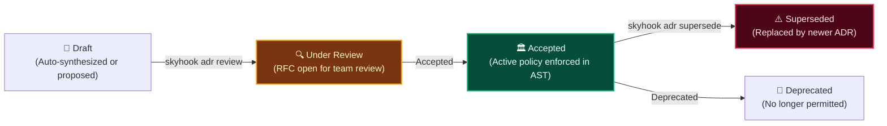
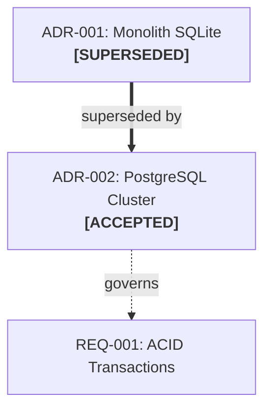

# Architectural Decision Records (ADRs) & Policy Governance

Skyhook provides an automated **Architectural Decision Record (ADR)** engine that transforms architectural decisions from passive text into **active, enforceable code boundary policies**.

---

## 1. ADR Lifecycle & Decision DAG

Architectural decisions evolve through a rigorous state machine:



### Visual Decision DAG
Run `skyhook adr dag` to generate the interactive Mermaid DAG visualizing decision lineages, supersession chains, and governed requirements:



---

## 2. Reverse-Engineering Brownfield Baselines

When introducing Skyhook to an existing codebase, running `skyhook adr bootstrap` inspects all installed packages, frameworks, database drivers, and configuration files, automatically generating baseline accepted ADRs:

```bash
skyhook adr bootstrap
```
Output:
```
✓ Bootstrapped 4 baseline ADRs:
  - ADR-001: Use React 18 for Frontend User Interface
  - ADR-002: Use PostgreSQL with Prisma ORM for Relational Storage
  - ADR-003: Use TypeScript Strict Mode for Type Safety
  - ADR-004: Use Express for REST API Service Layer
```

---

## 3. Active Policy Guard ("Decisions with Teeth")

Unlike static ADRs that sit in a wiki, Skyhook's [`ADRPolicyCompiler.js`](file:///Users/asad/Documents/Codex/2026-08-29/wh/skyhook-repo/skyhook/lib/adr/ADRPolicyCompiler.js) parses the decision text and compiles enforceable AST rules. The [`ADRPolicyGuard.js`](file:///Users/asad/Documents/Codex/2026-08-29/wh/skyhook-repo/skyhook/lib/adr/ADRPolicyGuard.js) then leverages [`ASTImportGraph.js`](file:///Users/asad/Documents/Codex/2026-08-29/wh/skyhook-repo/skyhook/lib/drift/ASTImportGraph.js) to audit module dependencies across polyglot repositories.

### Polyglot AST Import Extraction
Skyhook inspects dependency imports natively across 5 major language ecosystems:
- **JavaScript & TypeScript**: ES modules (`import`, `export ... from`), dynamic `import()`, and CommonJS `require()`. Resolves `tsconfig.json` path aliases (`@/`).
- **Python**: Package imports (`import foo`, `import foo as bar`) and selective member imports (`from foo.bar import baz`).
- **Go**: Standard single imports (`import "fmt"`) and grouped block imports (`import ( "net/http" "github.com/gin-gonic/gin" )`).
- **Rust**: Crate, super, and submodule imports (`use crate::storage::DB;`, `pub use super::engine;`, `mod handlers;`).
- **Java / Kotlin / C#**: Package imports (`import java.util.Date;`, `import static ...;`, `using System.IO;`).

### Multi-Language Policy Examples in ADR Markdown

ADR decision markdown files (`.skyhook/decisions/records/ADR-XXX.md`) declare enforceable boundary rules under standard Markdown list headings:

```markdown
## Invariants & Boundary Rules

### JavaScript / TypeScript Rules (ADR-002: Native Fetch Standardization)
- Prohibit import 'axios' in 'src/'
- Enforce import 'pg' only in 'src/infrastructure/db/'

### Python Rules (ADR-003: HTTPX Migration & Domain Purity)
- Prohibit import 'requests' in 'app/'
- Prohibit import 'sqlite3' in 'app/domain/'

### Go Rules (ADR-004: Clean Architecture Layer Boundaries)
- Prohibit import 'database/sql' in 'internal/domain/'
- Enforce import 'github.com/jackc/pgx' only in 'internal/infrastructure/storage/'

### Rust Rules (ADR-005: Async Safety Invariants)
- Prohibit import 'std::sync::Mutex' in 'src/async_engine/'
- Enforce import 'tokio::sync::Mutex' in 'src/async_engine/'

### Java Rules (ADR-006: Modern Date/Time API Invariant)
- Prohibit import 'java.util.Date' in 'src/main/java/'
- Prohibit import 'org.apache.log4j' in 'src/main/java/'
```

### Verification via CLI:
```bash
skyhook adr verify
```
If an AI agent or human commits code importing prohibited packages or breaching architectural layer boundaries, the policy guard halts the operation:
```
✖ ADR Policy Violations Detected! (2 failures across 5 active rules)

  Violation 1:
    File: src/services/PaymentService.ts:4
    Import: import axios from 'axios'
    Rule: Prohibit import 'axios' (Governed by ADR-002: Native Fetch Standardization)

  Violation 2:
    File: app/api/routes.py:12
    Import: from requests import post
    Rule: Prohibit import 'requests' in 'app/' (Governed by ADR-003: HTTPX Migration)
```

---

## 4. Git Pre-Commit Hook Integration

To guarantee that no rogue dependencies or architectural violations enter version control, install the pre-commit hook:

```bash
# Install hook
skyhook hook install

# Check status
skyhook hook status

# Uninstall if needed
skyhook hook uninstall
```

When installed in `.git/hooks/pre-commit`, git commits are automatically verified in `<50ms`. If an accepted ADR policy is violated, the commit is aborted.

---

## 5. Proactive Interception Daemon

Skyhook's [`ADRInterceptionDaemon.js`](file:///Users/asad/Documents/Codex/2026-08-29/wh/skyhook-repo/skyhook/lib/adr/ADRInterceptionDaemon.js) scans package manifests (`package.json`, `Cargo.toml`, `go.mod`, `requirements.txt`) and database migrations on `skyhook sync` or `skyhook adr intercept`.

When it detects an unrecorded library (e.g. `npm install redis`), it proactively drafts a candidate ADR:

```bash
$ skyhook adr intercept
⚠ Detected 1 unrecorded architectural package addition: 'ioredis'
✓ Auto-drafted candidate ADR: .skyhook/decisions/records/ADR-005.md (Status: DRAFT)
```
