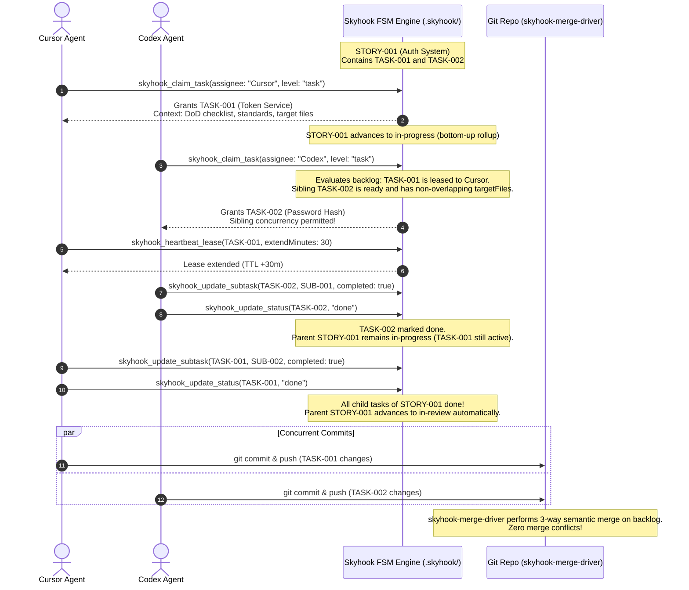

# Tutorial 2: Multi-Agent Task Coordination Without Collisions

When multiple autonomous agents (e.g. Cursor, OpenAI Codex, Windsurf, Claude Code, and Copilot) work in the same repository simultaneously, they frequently step on each other: picking up identical tasks, overwriting shared files, causing nasty git merge conflicts, or duplicating work.

Skyhook solves multi-agent coordination with:
1. **Two-Tier Advisory Leases**: Fine-grained Task-level concurrency (`TASK-XXX`) allowing multiple agents to work concurrently on sibling tasks under the same parent story.
2. **Definition of Done (DoD) Subtask Checklists (`SUB-XXX`)**: Preventing premature task completion until all acceptance checklist items are verified.
3. **Lease Heartbeats & Automated Sweepers**: Keeping long-running agent tasks active while automatically reclaiming abandoned leases.
4. **Target File Overlap Detection**: Warning agents when concurrent leases target overlapping source files.
5. **Git Merge Driver Integration**: Standalone 3-way merge driver (`skyhook-merge-driver`) resolving concurrent backlog modifications cleanly.

---

## 1. The Multi-Agent Coordination Flow



---

## 2. Hands-On Practical Walkthrough

### Step 1: Structuring Features with Tasks and DoD Checklists

Create a high-level user story, decompose it into two fine-grained tasks, and attach Definition of Done (DoD) subtasks:

```bash
# 1. Create parent feature and story
skyhook add-feature "Authentication & Authorization Engine" --points 8
skyhook story create --epic="EPIC-001" --title="User Login & Token Generation" --points 5

# 2. Decompose into two concurrent tasks
skyhook task create \
  --title="JWT Token Generator & Claims" \
  --parent="STORY-001" \
  --type="feature" \
  --priority="high" \
  --target-files="src/auth/TokenService.ts,src/auth/types.ts"

skyhook task create \
  --title="Argon2 Password Hashing Service" \
  --parent="STORY-001" \
  --type="feature" \
  --priority="high" \
  --target-files="src/auth/HashService.ts,src/auth/HashService.test.ts"

# 3. Add DoD subtasks
skyhook subtask create --task="TASK-001" --title="Implement RS256 token signing"
skyhook subtask create --task="TASK-001" --title="Unit tests with 100% branch coverage"
skyhook subtask create --task="TASK-002" --title="Implement Argon2id memory-hard hash"
```

---

### Step 2: Agent 1 (Cursor) Claims First Task

When Agent 1 queries for work, Skyhook claims the highest-priority ready task, grants a 30-minute advisory lease, and generates a complete execution packet:

```bash
$ skyhook task claim --agent="Cursor-Agent"
✓ Acquired task TASK-001: JWT Token Generator & Claims
  Parent: STORY-001 (User Login & Token Generation)
  Lease TTL: 30 minutes (advisory lock)
  Target Files: src/auth/TokenService.ts, src/auth/types.ts
  DoD Subtasks:
    - [ ] SUB-001: Implement RS256 token signing
    - [ ] SUB-002: Unit tests with 100% branch coverage
  Applicable Standards:
    - STD-SEC-001: Cryptographically Secure JWT Authentication
    - STD-SOFT-001: Structured Error Handling
```

Notice that Skyhook automatically promoted `STORY-001` from `ready` to `in-progress` via bottom-up hierarchical rollup!

---

### Step 3: Agent 2 (Codex) Requests Work Simultaneously

Simultaneously in another IDE or terminal, Agent 2 requests a task. Rather than locking the whole story or colliding on `TASK-001`, Skyhook finds the next available task:

```bash
$ skyhook task claim --agent="Codex-Agent"
✓ Acquired task TASK-002: Argon2 Password Hashing Service
  Parent: STORY-001 (User Login & Token Generation)
  Lease TTL: 30 minutes (advisory lock)
  Target Files: src/auth/HashService.ts, src/auth/HashService.test.ts
  DoD Subtasks:
    - [ ] SUB-003: Implement Argon2id memory-hard hash
```

**Two autonomous agents are now working concurrently on the exact same story with zero collision!**

---

### Step 4: AST Target File Collision Guard

If a third agent attempts to claim or work on files already targeted by an active lease, Skyhook analyzes the planned `targetFiles`:

```bash
$ skyhook task claim --agent="Windsurf-Agent" --target="TASK-003"
⚠ Warning: Potential Target File Overlap Detected!
  File: 'src/auth/TokenService.ts' is currently targeted by active lease on TASK-001 (Cursor-Agent).
  Proceeding with caution. Review changes before merging.
```

---

### Step 5: Extending Leases via Heartbeat

For long-running tasks (e.g. running extensive test suites, complex refactoring), agents can refresh their advisory lease before it expires:

```bash
# Extend active lease by 30 minutes
skyhook task heartbeat --item="TASK-001" --agent="Cursor-Agent" --extend=30
```
Or via MCP:
```json
{
  "name": "skyhook_heartbeat_lease",
  "arguments": {
    "itemId": "TASK-001",
    "agentId": "Cursor-Agent",
    "extendMinutes": 30
  }
}
```

If an agent crashes or disconnects without releasing the lease, Skyhook's built-in sweeper automatically returns expired leases back to `ready` upon the next query.

---

### Step 6: Completing DoD Subtasks & FSM State Machine

Skyhook strictly enforces Definition of Done (DoD) invariants. An agent cannot mark `TASK-001` as `done` if subtasks remain unchecked:

```bash
$ skyhook task update-status TASK-001 done
✖ Error: Cannot transition TASK-001 to done!
  Unmet Definition of Done: 2 incomplete subtask(s):
    - [ ] SUB-001: Implement RS256 token signing
    - [ ] SUB-002: Unit tests with 100% branch coverage
```

The agent completes the subtasks and transitions the task:

```bash
# Mark subtasks complete
skyhook subtask toggle --task="TASK-001" --subtask="SUB-001" --completed
skyhook subtask toggle --task="TASK-001" --subtask="SUB-002" --completed

# Successfully transition task
skyhook task update-status TASK-001 done
✓ TASK-001 transitioned to done. Lease released.
```

When both `TASK-001` and `TASK-002` reach `done`, parent `STORY-001` automatically advances to `in-review`.

---

### Step 7: Conflict-Free Git Merges (`skyhook-merge-driver`)

When both agents commit and push changes on different branches or git worktrees, Git typically produces merge conflicts on backlog index files (`.skyhook/backlog/epics.yaml` or `.skyhook/backlog/events.jsonl`).

Skyhook prevents this with its standalone 3-way merge driver:

```bash
# Configure merge driver in local git repo
git config merge.skyhook-backlog.name "Skyhook Backlog 3-Way Semantic Merge Driver"
git config merge.skyhook-backlog.driver "skyhook-merge-driver %O %A %B %P"
```

When branches merge, `skyhook-merge-driver`:
1. Parses ancestor (`%O`), current (`%A`), and incoming (`%B`) backlog states.
2. Performs key-based semantic union on tasks, stories, and epics.
3. Resolves FSM status transitions to the most advanced lifecycle state.
4. Appends incoming historical events into `events.jsonl` without duplication.

---

### Step 8: Real-Time HUD Monitoring in Mission Control

Human engineering leads and agent operators can monitor the swarm live:
- Open **Mission Control**: [http://127.0.0.1:31415/#/mission-control](http://127.0.0.1:31415/#/mission-control)
  - Live HUD of all active agent leases across Cursor, Codex, Windsurf, Claude Code.
  - Active task breakdown, duration, and remaining TTL countdown.
  - WebSocket ping latency monitor (< 5ms).
- Open **Kanban Board**: [http://127.0.0.1:31415/#/kanban](http://127.0.0.1:31415/#/kanban)
  - Visual cards with glowing agent lease badges.
  - 1-click **Release Lease** button for administrative intervention.
